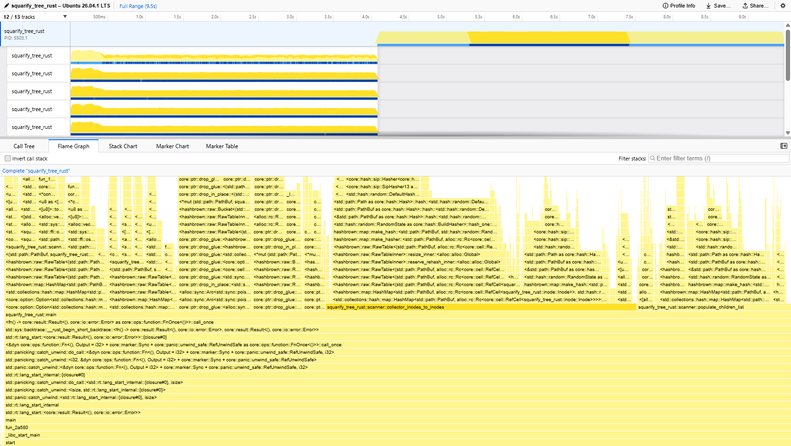
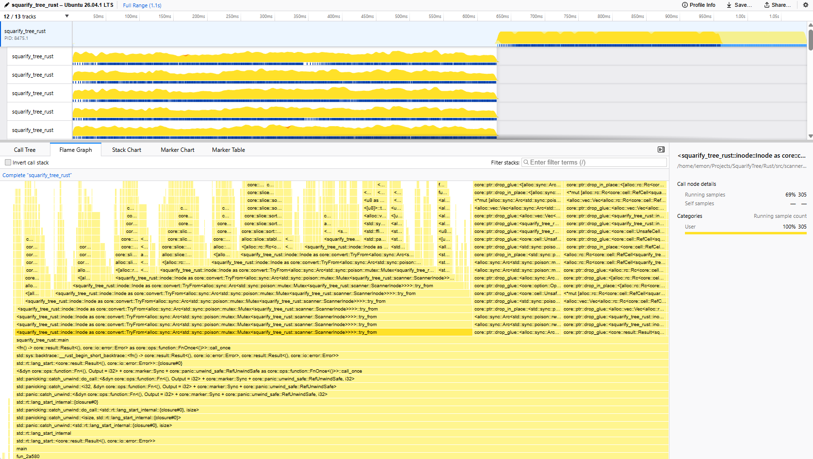

#+TITLE: Week 44, 2026 (Oct 26 - Nov 01)

* Profiling and Optimization

During the process of porting the utility to Rust, I implemented the algorithm for directory scanning twice. The first time is a proof of concept, the second time is to simplify the logic.

The readability of the second implementation was improved significantly, but the performance took a large penalty to an unacceptable degree. The performance was multiple times slower than ~ncdu~ when using only one thread.

To solve this, I had to learn profiling. I followed [[https://youtu.be/M_EniM_IfnQ?si=QDi6APUex5uJpsPD][a video]] [fn:1] by [[https://www.youtube.com/@FedericoTerzi][Federico Terzi]] [fn:2] on YouTube. The tutorial suggested to use [[https://github.com/mstange/samply][~samply~]]. I think it was a decent choice for a beginner, where it automatically opens the Firefox Profiler on my behalf. Still, I want to learn to read the raw output of commands like ~perf~, in the case I only have terminal access.

The discovery is as followed:
- A large amount of the time is spent doing cleanup after scanning in the main thread. 
- The majority of computation done by the collector and the cleanup are taken up by hashmap insertion and lookup.

Thus it seems the reducing the amount of hashmap access will give us a performance increase. The cleanup process accesses the hashmap on two occassions:
1. ~collector_inodes_to_inodes()~ :: This function converts the multithread-safe inodes into inodes suitable for singlethreaded operations, so the program does not pay for overhead in the future.
2. ~populate_children()~ :: This function populates the logical inodes of directory with their children.

In essense ~populate_children()~ traverses the file structure for a second time, which is very wasteful. This was a tradeoff I was willing to try for the sake of readability. However, seeing the performance penalty, I have now decided to sacrifice readability. I do not think there is a easy way to address the computation cost of ~collector_inodes_to_inodes()~ without completely reworking the logic, so I am postponing that to later. 

To address the issue, I refactored the code such while the scanner threads scans a directory, it also populates the logical inode with its children. For now, this requires adding shared states between threads.

** Data

I believe the performance boost is worth it.

For a fixed directory, the old algorithm took 10s to complete the scan and the cleanup. The new algorithm usually takes only 1s, and up to 3s on a cold start.

#+CAPTION: Before optimization.

#+CAPTION: Post optimization.

* Footnotes
[fn:2] YouTube, [[https://www.youtube.com/@FedericoTerzi][Federico Terzi]]

[fn:1] YouTube, [[https://youtu.be/M_EniM_IfnQ?si=QDi6APUex5uJpsPD][Performance Optimizatin in Rust - How to Profile with Samply (Nov 01, 2026)]] 
